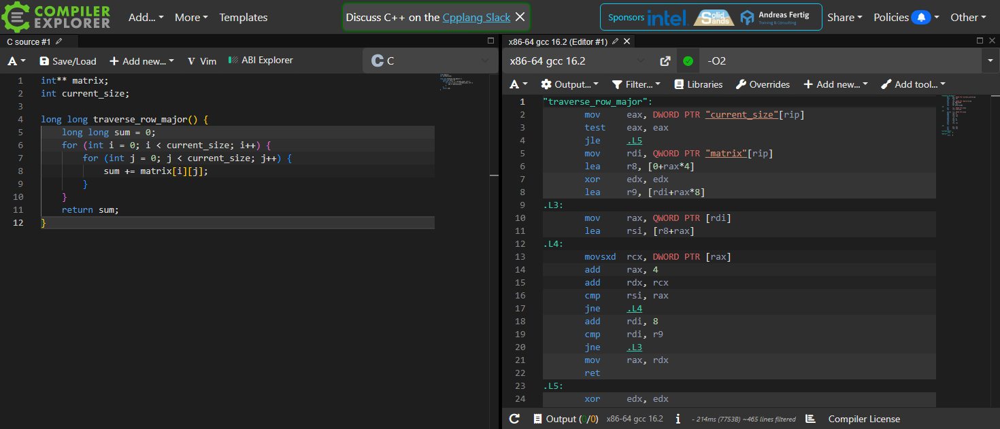
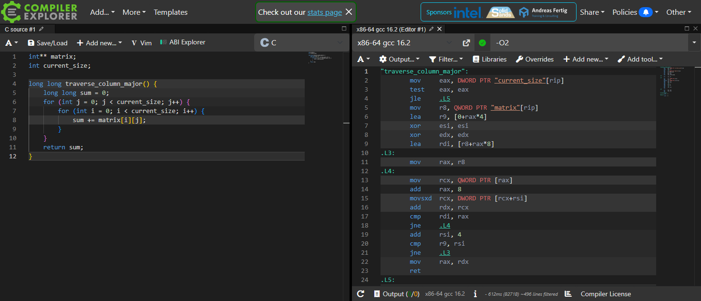

# Cache Behavior Lab: Analysis

**Test machine:** Windows 11, compiled with `gcc (tdm64-1) 10.3.0`. All times come from the program's `clock()` instrumentation, in milliseconds. On Windows `clock()` only measures in steps of about 1 ms, so the 1000 x 1000 results are noisy.

---

## Section 1: Performance Measurements

Compiled with `gcc cache_lab.c -o cache_lab` (no optimization flag, so GCC's default of `-O0`).

| Matrix Size | Row-Major (ms) | Column-Major (ms) | Ratio (col / row) |
|-------------|---------------:|------------------:|------------------:|
| 1000 x 1000 | 3   | 5   | 1.67x |
| 2000 x 2000 | 9   | 23  | 2.56x |
| 4000 x 4000 | 36  | 166 | 4.61x |
| 8000 x 8000 | 153 | 441 | 2.88x |

Both methods returned the same sum at every size (for example, 3,168,000,000 for 8000 x 8000), so the two functions do the same work. At 1000 x 1000 the matrix is about 4 MB, which fits mostly in the CPU caches, so the gap is small. Once the matrix grows well beyond the cache (16 MB at 2000, 64 MB at 4000, 256 MB at 8000), column-major is consistently several times slower.

---

## Section 2: Optimization Level Comparison

| Matrix Size | -O0 Row | -O0 Col | -O0 Ratio | -O2 Row | -O2 Col | -O2 Ratio | -O3 Row | -O3 Col | -O3 Ratio |
|-------------|--------:|--------:|----------:|--------:|--------:|----------:|--------:|--------:|----------:|
| 1000 x 1000 | 3   | 2   | 0.67x | 1  | 1   | 1.00x  | 1  | 1   | 1.00x  |
| 2000 x 2000 | 8   | 18  | 2.25x | 2  | 7   | 3.50x  | 1  | 9   | 9.00x  |
| 4000 x 4000 | 31  | 118 | 3.81x | 9  | 81  | 9.00x  | 9  | 81  | 9.00x  |
| 8000 x 8000 | 129 | 427 | 3.31x | 34 | 402 | 11.82x | 27 | 401 | 14.85x |

(The 0.67x at -O0 / 1000 is timer noise. Both runs took only 2–3 ms, which is close to the timer's 1 ms resolution.)

**Does `-O3` eliminate the gap?** No, it makes the gap larger. Optimization sped row-major up by about 5x (153 ms → 27 ms at 8000) because it removed instruction overhead such as stack loads and stores. Column-major barely changed (441 ms → 401 ms) because its time is spent waiting on main memory, which the compiler cannot speed up. Since only the instruction cost went down, the memory cost now accounts for almost all of the column-major time, and the ratio rises from about 3x to about 15x.

---

## Section 3: Assembly Analysis

Both functions were pasted into Compiler Explorer (godbolt.org) with compiler `x86-64 gcc 16.2` and flag `-O2`.

**`traverse_row_major()` at -O2:**



**`traverse_column_major()` at -O2:**



The annotated listings below were produced locally with `gcc 10.3 -O2 -S -masm=intel`. Their structure matches the Godbolt output; only the register names and label numbers differ.

**Inner loop of `traverse_row_major()`:**

```asm
.L55:                                   ; outer loop: once per row
    mov   rax, QWORD PTR [rax]          ; load pointer to matrix[i]
    lea   rcx, [r10+rax]                ; end-of-row address
.L54:                                   ; inner loop: once per element
    movsx rdx, DWORD PTR [rax]          ; load matrix[i][j]
    add   rax, 4                        ; next element: +4 bytes
    add   r8, rdx                       ; sum += ...
    cmp   rcx, rax
    jne   .L54
```

**Inner loop of `traverse_column_major()`:**

```asm
.L62:                                   ; outer loop: once per column
    mov   rax, r11                      ; restart at matrix[0]
.L61:                                   ; inner loop: once per element
    mov   rdx, QWORD PTR [rax]          ; load pointer to matrix[i]
    add   rax, 8                        ; next row pointer
    movsx rdx, DWORD PTR [rdx+rcx]      ; load matrix[i][j]
    add   r8, rdx                       ; sum += ...
    cmp   r9, rax
    jne   .L61
    add   rcx, 4                        ; next column: +4 bytes
    cmp   rcx, r10
    jne   .L62
```

**Do the two functions generate significantly different assembly?** No. Both are short nested loops built from the same instructions: `movsx` to load and sign-extend an `int`, `add` to accumulate into `r8`, then `cmp`/`jne`. The column-major inner loop has one extra instruction, because it has to reload the row pointer `matrix[i]` on every element. The row-major loop loads that pointer once per row. That makes the inner loop 6 instructions instead of 5, about 20% more work, which cannot account for a 9–15x slowdown.

**What this tells us:** The assembly is almost the same but the speed is not, so the difference does not come from the instructions the CPU runs. It comes from the memory addresses those instructions use. Row-major moves forward 4 bytes at a time through one contiguous block. Column-major visits a different row, which is a separate block of memory, on every iteration. The extra time is spent in the memory hierarchy (cache misses and DRAM latency), not in computation. Assembly only shows *what* gets loaded, not *where* it comes from or how long the load takes.

---

## Section 4: Cache Behavior Explanation

C stores 2D arrays in row-major order. In an array declared `int a[N][N]`, all of row 0 is stored contiguously, then all of row 1 immediately after it, and so on, so `a[i][j]` and `a[i][j+1]` are 4 bytes apart while `a[i][j]` and `a[i+1][j]` are `N * 4` bytes apart. In this lab the matrix is an `int**`, where each row is its own `malloc` block. The rule still holds: the elements inside a row are contiguous, and different rows sit in separate, far-apart regions of the heap. For an 8000-column matrix, moving down one row jumps at least 32,000 bytes.

The CPU never fetches a single `int` from RAM. It fetches a whole 64-byte cache line, which holds 16 consecutive `int`s. During row-major traversal, reading `matrix[i][0]` misses and brings in `matrix[i][0]` through `matrix[i][15]`, so the next 15 reads are cache hits. That is one miss for every 16 elements. The access pattern is also a simple forward stride, which the hardware prefetcher recognizes, so it starts loading upcoming lines before the loop asks for them. Most of the memory latency is hidden, and the loop runs close to the speed of the arithmetic.

During column-major traversal, each step jumps to a different row, so every access touches a new cache line, and the loop uses only 4 of the 64 bytes it fetched. The neighboring elements in that line are not needed until the next column pass, and by then the line has been evicted: one pass touches 8,000 lines (512 KB), more than L1 and L2 hold. Nearly every access becomes a cache miss that waits on DRAM, and the CPU moves 16 times more data than it uses. This is why the gap grows as the matrix grows: at 1000 x 1000 the data mostly fits in cache and the ratio is close to 1x, while at 8000 x 8000 it reaches about 15x.

The compiler cannot fix this through optimization because the slowdown comes from the data layout, not from wasted instructions. Flags like `-O2` and `-O3` keep values in registers and remove redundant work, but they leave the memory access order unchanged. GCC will not swap the loops here, because with a global `int**` it cannot prove the change is safe. The fix has to come from the programmer, who must write loops that follow the memory layout.

### Connection to Final Project

My final project, LiftLog, processes a 5-million-set workout log. The baseline stores every set as a separately `malloc`'d linked-list node, so walking it jumps around the heap the same way column-major traversal does here. In the optimized version I will store all sets in one contiguous array of 16-byte `Set` structs with no pointers or padding (four sets per 64-byte cache line), and give each user a flat stats array indexed by an integer exercise ID instead of a linked list searched with `strcmp`. My main loop will read that array front to back, like row-major traversal, so every fetched cache line is fully used and the prefetcher can load ahead. I will also sort sets by user ID so each user's stats stay in cache while their sets are processed, and I will use cachegrind or `perf stat` to show the drop in cache misses.
